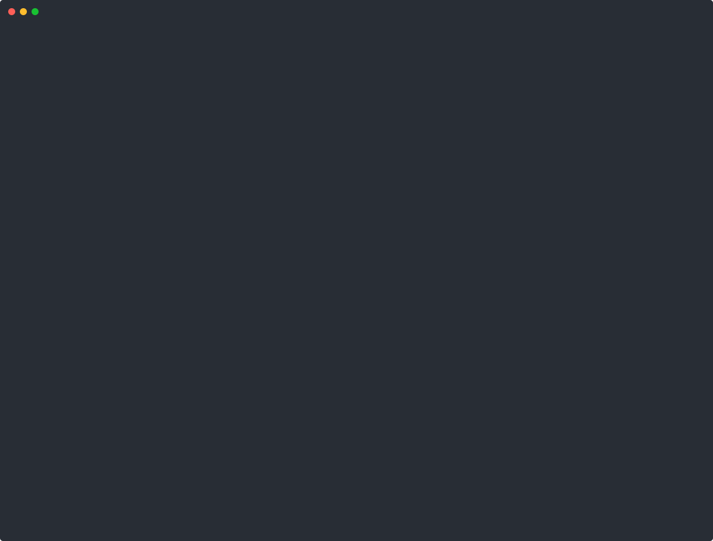

# gpu-doctor

[](https://github.com/snehanagmoti/gpu-doctor/actions/workflows/ci.yml)
[](LICENSE)

**Read-only diagnostics for NVIDIA driver and CUDA setups on Ubuntu.**

`gpu-doctor` finds the problems people post on AskUbuntu every day: the GPU
stopped working after a kernel upgrade, nouveau grabbed the GPU, Secure Boot
rejected the driver, `nvidia-smi` says *Driver/library version mismatch*, or
CUDA is too new for the driver. For each problem it explains what is wrong in
plain language and prints the exact commands that fix it.

It **never changes your system**. It only suggests commands; you decide whether
to run them.

Supported: Ubuntu 22.04 LTS and 24.04 LTS (and derivatives), Python 3.10+, no
third-party runtime dependencies.



<sub>The demo diagnoses two of the test suite's simulated machines through
`--root`, so it can be re-recorded anywhere (`scripts/record-demo.py`). Try
any broken setup yourself with `python3 scripts/make-demo-root.py --list`.</sub>

## Example

After a kernel upgrade on a machine that builds the driver with DKMS, without
the matching headers (output generated from the test suite's
`dkms_missing_after_kernel_upgrade` scenario):

```text
$ gpu-doctor
gpu-doctor 0.1.0: read-only NVIDIA driver diagnostics

PASS  System information                   Ubuntu 24.04.1 LTS, kernel 6.8.0-47-generic, x86_64
PASS  NVIDIA GPU present                   1 NVIDIA GPU: AD102 [GeForce RTX 4090] (0000:01:00.0)
PASS  Driver package installed             nvidia-driver-550 550.120 (proprietary kernel modules)
FAIL  Kernel module loaded                 The nvidia kernel module is not loaded
      Without the kernel module no program can use the GPU. If you have just installed or upgraded
      the driver, reboot first. Otherwise the checks below point at the usual causes: nouveau
      holding the GPU, no module built for the running kernel, or Secure Boot rejecting an unsigned
      module. Loading it by hand shows the kernel's exact error.
      Suggested commands (review before running):
        $ sudo modprobe nvidia
        $ sudo dmesg | grep -iE 'nvidia|nouveau'

FAIL  Module built for running kernel      DKMS has not built the nvidia module for the running
                                           kernel 6.8.0-47-generic
      DKMS has nvidia 550.120 built only for: 6.8.0-45-generic. This usually happens after a kernel
      upgrade when the matching linux-headers package was missing or the build failed. Install the
      headers, rebuild, and reboot.
      Suggested commands (review before running):
        $ sudo apt install linux-headers-$(uname -r)
        $ sudo dkms autoinstall
        $ sudo reboot

FAIL  Kernel headers installed             Kernel headers for 6.8.0-47-generic are not installed
      DKMS compiles the nvidia module against the headers of each kernel. Without headers for the
      running kernel it cannot build the module.
      Suggested commands (review before running):
        $ sudo apt install linux-headers-$(uname -r)
        $ sudo dkms autoinstall

PASS  No nouveau conflict                  nouveau is not loaded (blocked by
                                           /lib/modprobe.d/nvidia-graphics-drivers.conf)
PASS  Secure Boot and module signing       Secure Boot is disabled, so unsigned modules can load
SKIP  Module and library versions match    Skipped: depends on 'Kernel module loaded', which did not
                                           pass
FAIL  nvidia-smi works                     nvidia-smi failed: NVIDIA-SMI has failed because it
                                           couldn't communicate with the NVIDIA driver. Make sure
                                           that the latest NVIDIA driver is installed and running.
      The nvidia kernel module is not loaded; see the checks above for why.

PASS  CUDA toolkit compatible with driver  CUDA 12.4.1 is fully supported (needs driver >=
                                           550.54.15)
SKIP  Docker GPU support                   Docker is not installed
SKIP  Hybrid graphics (PRIME)              Not a hybrid-graphics system

6 passed, 0 warnings, 4 failed, 3 skipped. Nothing on this system was changed.
```

Add `--verbose` to see the evidence behind each result (which file was read
and what it contained).

## Install

> The PPA and the Snap Store listing go live with the first published
> release. Until then, install from source or build the `.deb` yourself
> (see Development).

**From the PPA** (Ubuntu 22.04 and 24.04):

```sh
sudo add-apt-repository ppa:snehanagmoti/gpu-doctor
sudo apt install gpu-doctor
```

**As a snap** (strict confinement, see [docs/snap.md](docs/snap.md) for what
that means for the checks):

```sh
sudo snap install gpu-doctor
sudo snap connect gpu-doctor:hardware-observe
sudo snap connect gpu-doctor:kernel-module-observe
```

**From source**:

```sh
git clone https://github.com/snehanagmoti/gpu-doctor.git
cd gpu-doctor
PYTHONPATH=src python3 -m gpudoctor   # run without installing
pip install .                          # or install it
```

## Usage

```text
gpu-doctor                      run every check
gpu-doctor --verbose            also show the evidence for each check
gpu-doctor --check secure_boot  run one check (plus the checks it depends on)
gpu-doctor --json               machine-readable output
gpu-doctor --report             redacted text block for bug reports and forum posts
gpu-doctor --list-checks        list check ids
sudo gpu-doctor                 a few files (e.g. some efivars) are root-only
```

Colour is used only on a terminal and is disabled by the
[`NO_COLOR`](https://no-color.org/) environment variable or `--color never`.

### Exit status

| Code | Meaning |
|---|---|
| 0 | every check passed or was skipped |
| 1 | at least one warning |
| 2 | at least one failure |
| 3 | gpu-doctor itself failed: bad arguments or an internal error |

Usage errors deliberately exit 3, not argparse's default 2, so that scripts
can tell "your system has a problem" from "you called the tool wrong".

## Checks

| Id | What it looks at | Typical fix it suggests |
|---|---|---|
| `system_info` | `/etc/os-release`, `/proc/sys/kernel/osrelease`, architecture, container detection | (information) |
| `gpu_present` | `/sys/bus/pci/devices/*/{vendor,class,device}`, `lspci -nn` as fallback | GPU passthrough on VMs |
| `driver_package` | `/var/lib/dpkg/status`: `nvidia-driver-*`, `.run` installs, mixed driver branches | `sudo ubuntu-drivers install` |
| `kernel_module` | `/proc/modules`, `/proc/driver/nvidia/version` | `sudo modprobe nvidia`, reboot |
| `module_build` | Canonical's prebuilt `linux-modules-nvidia-*` for the running kernel, or `/var/lib/dkms/nvidia/*/<kernel>` | `sudo dkms autoinstall`, install the per-kernel module package |
| `kernel_headers` | `/lib/modules/<kernel>/build`, the `linux-headers-<flavour>` metapackage (DKMS only) | `sudo apt install linux-headers-$(uname -r)` |
| `nouveau` | `/proc/modules`, blacklists in `modprobe.d` and on `/proc/cmdline` | blacklist nouveau, `update-initramfs -u` |
| `secure_boot` | `SecureBoot-…` EFI variable, DKMS MOK key enrolment (`mokutil --test-key`) | `sudo mokutil --import …`, reboot, *Enroll MOK* |
| `version_mismatch` | loaded module version vs `libnvidia-ml.so.<version>` | reboot after a driver upgrade |
| `nvidia_smi` | `nvidia-smi --query-gpu=…` | depends on the error |
| `cuda_compat` | `/usr/local/cuda-*/version.json`, `nvidia-cuda-toolkit`, `nvcc` vs [a table from NVIDIA's release notes](src/gpudoctor/data/cuda_driver_matrix.json) | newer driver branch or older CUDA |
| `container_toolkit` | Docker + `nvidia-container-toolkit` + `/etc/docker/daemon.json` | `nvidia-ctk runtime configure` |
| `prime` | `/etc/prime-discrete`, `prime-select query` on hybrid laptops | `sudo prime-select on-demand` |

Checks declare dependencies: when there is no NVIDIA GPU, the GPU-specific
checks are skipped rather than reporting a cascade of failures.

## JSON output

`--json` prints one object, documented by [docs/json-schema.json](docs/json-schema.json)
and explained in [docs/json-output.md](docs/json-output.md):

```json
{
  "schema_version": 1,
  "tool": {"name": "gpu-doctor", "version": "0.1.0"},
  "overall_status": "fail",
  "exit_code": 2,
  "checks": [
    {
      "id": "module_build",
      "title": "Module built for running kernel",
      "status": "fail",
      "summary": "DKMS has not built the nvidia module for the running kernel 6.8.0-47-generic",
      "explanation": "…",
      "fixes": ["sudo apt install linux-headers-$(uname -r)", "sudo dkms autoinstall", "sudo reboot"],
      "evidence": [{"source": "/var/lib/dkms/nvidia/550.120", "value": "built for: 6.8.0-45-generic"}],
      "facts": {"module_source": "dkms", "kernel": "6.8.0-47-generic"},
      "internal_error": false
    }
  ]
}
```

## How it works

Every check reads the system only through a `SystemProbe` object that is
passed in (dependency injection). The real program uses `HostProbe`, rooted at
`/`. The tests use `FakeProbe`, rooted at a temporary directory containing a
hand-built fake `/proc`, `/sys` and `/var/lib/dpkg`, plus canned command
output. That is how a laptop without an NVIDIA GPU tests "Secure Boot on and
the MOK key not enrolled". See [docs/design.md](docs/design.md).

The tool prefers reading files to running programs: files under `/proc`,
`/sys`, `/var/lib/dpkg` and `/var/lib/dkms` are readable from inside a strictly
confined snap, where host binaries such as `dkms`, `mokutil` and `dpkg-query`
are not available.

## Development

```sh
pip install pytest pytest-cov ruff mypy
pytest --cov                # 85% minimum, currently ~98%
ruff check . && ruff format --check .
mypy                        # strict, on src/
```

Build the Debian package and the snap:

```sh
sudo apt install build-essential debhelper dh-python python3-all python3-setuptools python3-pytest lintian devscripts
./scripts/build-deb.sh      # builds ../gpu-doctor_*.deb and runs lintian
snapcraft pack              # needs snapcraft and LXD or Multipass
```

See [CONTRIBUTING.md](CONTRIBUTING.md) for the workflow and
[docs/packaging.md](docs/packaging.md) for how the Debian package and PPA
uploads work.

## License

GPL-3.0-or-later. See [LICENSE](LICENSE).

"Ubuntu" is a trademark of Canonical Ltd. and "NVIDIA" and "CUDA" are
trademarks of NVIDIA Corporation. This project is not affiliated with either.
